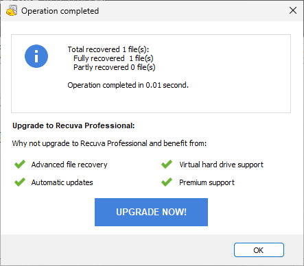
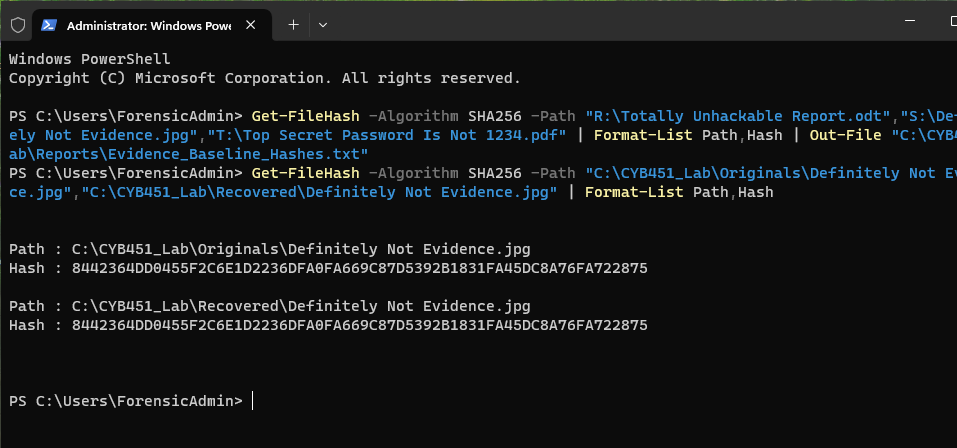
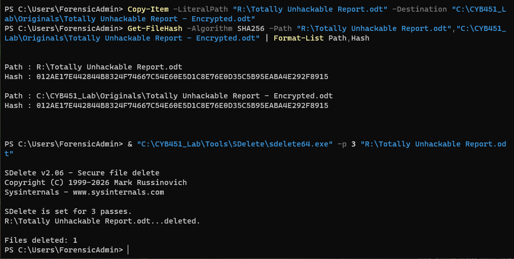
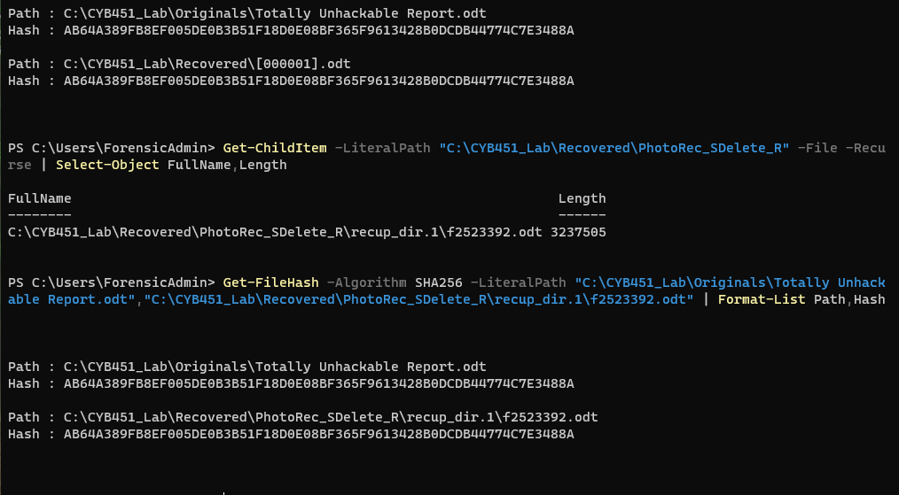
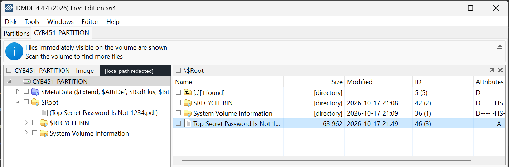
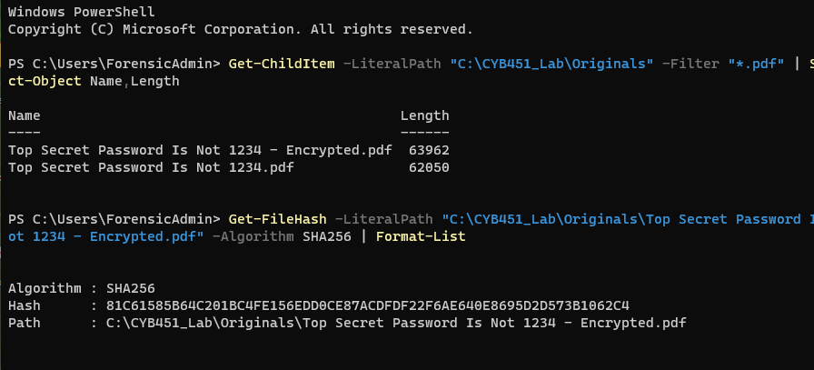
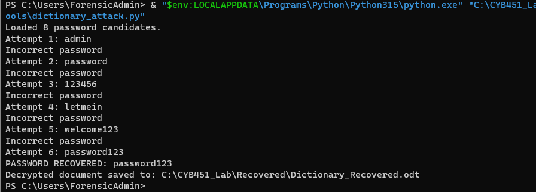
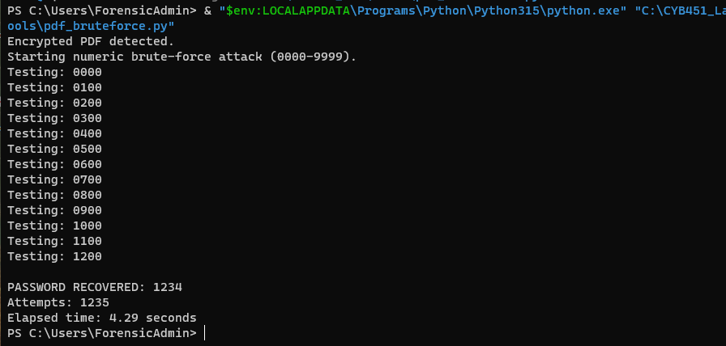

# Windows 11 Digital Forensics: File Recovery and Anti-Forensics Analysis

A hands-on, self-directed forensic testing environment built around **synthetic, user-created evidence**. The project examines how deletion methods affect recoverability, how different tools interpret deleted data, how an NTFS partition can remain recoverable after its partition entry is removed, and how weak passwords undermine otherwise strong document encryption.

> **Portfolio project:** Independently written documentation and reusable demonstration scripts derived from a controlled CYB/451 lab. This is not an upload of the university assignment, licensed lab manual, or submitted academic paper.

## Lab environment

| Component | Configuration |
| --- | --- |
| Host | HP EliteBook 640 G9, Windows 11 Pro |
| Guest | Windows 11 Enterprise Evaluation in Oracle VirtualBox |
| Evidence media | Separate **8 GiB virtual disk**, GPT, NTFS test volumes |
| Recovery utilities | Recuva, PhotoRec, TestDisk, DMDE |
| Deletion utilities | Windows Shift+Delete, `cipher /w`, Sysinternals SDelete, DiskPart |
| Password testing | Python, `odfdecrypt`, `pypdf`; John the Ripper extraction utility was also evaluated |
| Integrity checks | SHA-256 comparisons |

All experiments used fictional test files and intentionally weak demonstration passwords.

## Evidence files

- `Definitely Not Evidence.jpg`: image used for deletion and recovery tests.
- `Totally Unhackable Report.odt`: LibreOffice document used for recovery testing; an encrypted version was protected with the intentionally weak password `password123`.
- `Top Secret Password Is Not 1234.pdf`: PDF with an encrypted test copy protected by `1234`.

The actual test documents, complete disk images, and guest virtual disks are **not distributed** in this repository.

## Results at a glance

| Experiment | Procedure | Observed result | Interpretation |
| --- | --- | --- | --- |
| Ordinary file deletion | Shift+Delete JPEG; Recuva | Recovered JPEG with SHA-256 matching its original | Standard deletion did not erase the contents in this test |
| Free-space overwrite | `cipher /w` after JPEG deletion; Recuva standard/deep scan and PhotoRec | None of those scans recovered the JPEG | Consistent with effective overwriting in this test; **not** proof that no trace exists anywhere |
| Secure deletion and remnants | SDelete with three passes targeted the **encrypted** ODT; Recuva and PhotoRec | Tools located an **earlier unencrypted version**, identified by SHA-256 | Demonstrates why recovered files must be identified by content/hash; does **not** establish that SDelete failed on its target |
| Partition deletion | Deleted GPT partition with DiskPart; examined image using DMDE | Recovered the encrypted PDF from the deleted NTFS partition | Partition removal did not overwrite the file contents |
| Partition integrity | SHA-256 against preserved encrypted backup; open with password | **Identical SHA-256**, and the recovered PDF opened with its original password | Verified byte-for-byte identity with the backup |
| ODT dictionary test | Eight candidates, Python + `odfdecrypt` | `password123` found on attempt **6** | Weak password defeated a modern AES-256-GCM/Argon2id-protected document |
| PDF numeric brute force | Test `0000`–`9999`, Python + `pypdf` | `1234` found on attempt **1,235** in **4.29 s** | Small numeric password space was rapidly searched in the lab |

### Partition-recovery troubleshooting

TestDisk detected the deleted NTFS partition but stalled during scanning in this VirtualBox setup. VirtualBox logs recorded failed attempts to read from the evidence disk beginning at byte offset `8,589,934,592`, exactly at the 8 GiB disk boundary. Rather than treating the scan failure as data loss, I cloned the active virtual disk state into a standalone VDI, converted it to a raw image, and examined the image directly in DMDE on the host. DMDE found the deleted partition and extracted its 63,962-byte encrypted PDF. The original snapshot chain was left unchanged.

### Integrity verification

The PDF recovered with DMDE and the preserved encrypted backup had the same SHA-256 digest:

`81C61585B64C201BC4FE156EDD0CE87ACDFDF22F6AE640E8695D2D573B1062C4`

Hash matching supports **byte-for-byte equality of these two files**. It is not by itself a substitute for a complete chain-of-custody record.

## Visual evidence

Eight screenshots selected from 26 original lab captures illustrate the observed results. Images are cropped for readability; a local host path in the DMDE screenshot was redacted. The images complement the [detailed findings](docs/findings.md) and [evidence register](docs/evidence-register.csv). Captions intentionally distinguish what a screenshot proves from conclusions supported by the wider experiment.

### Deleted-file recovery and integrity

| Recuva deleted-file recovery | SHA-256 verification of JPEG |
|:--|:--|
| [](screenshots/05_Recuva_One_File_Recovered.png) | [](screenshots/06_Recuva_JPEG_SHA256_Match.png) |
| Recuva reported one fully recovered file. Content identity is checked separately in the adjacent SHA-256 screenshot. | PowerShell shows identical SHA-256 digests for the original and Recuva-recovered JPEG. |

### Anti-forensics and previous-file versions

| SDelete three-pass deletion | Identifying an earlier ODT version |
|:--|:--|
| [](screenshots/12_SDelete_Three_Pass_Execution.png) | [](screenshots/20_PhotoRec_Original_ODT_SHA256_Match.png) |
| SDelete reports three passes and one deleted file. This alone is not proof that no historical copies remain. | The PhotoRec-recovered ODT matches an **earlier unencrypted original**, not the encrypted SDelete target. This is not proof of SDelete failure. |

### Deleted-partition investigation

| Deleted partition file discovery | Preserved PDF baseline hash |
|:--|:--|
| [](screenshots/26_DMDE_Deleted_Partition_File_Discovered.png) | [](screenshots/23_Encrypted_PDF_Baseline_SHA256.png) |
| DMDE displays the deleted NTFS volume and its **63,962-byte encrypted PDF**. The image shows discovery, not a completed extraction. | SHA-256 baseline for the preserved encrypted PDF. This image alone does **not** compare the recovered file against the backup. |

### Offline password demonstrations

| ODT dictionary demonstration | PDF numeric-password demonstration |
|:--|:--|
| [](screenshots/24_ODT_Dictionary_Attack_Result.png) | [](screenshots/25_PDF_Four_Digit_Search_Result.png) |
| The offline Python dictionary test finds the lab ODT password on candidate **6 of 8**. | The four-digit numeric test finds the demo PDF password after **1,235 attempts in 4.29 seconds**. |

*All files and passwords shown belong to this controlled, synthetic lab. No unrelated or third-party files were targeted.*

## What I learned

1. A tool reporting a successful recovery is not the same as verifying **which version** was recovered.
2. Different recovery utilities use different methods, so results need independent validation.
3. A deleted partition's file system can remain accessible even when its partition entry is missing.
4. Virtualization errors can complicate forensic work. Inspecting an image outside the guest provided another route.
5. Weak passwords remain a major weakness even when document encryption uses modern cryptographic algorithms.

## Repository layout

```text
.
├── README.md
├── .gitignore
├── requirements.txt
├── scripts/
│   ├── odt_dictionary_demo.py
│   └── pdf_numeric_bruteforce_demo.py
├── docs/
│   ├── findings.md
│   └── evidence-register.csv
└── screenshots/
    ├── README.md
    └── 8 reviewed PNG screenshots (see visual evidence above)
```

The Python scripts are **cleaned-up, reusable versions** of the demonstrations performed during the lab. They were not independently re-tested after being refactored for this repository. They operate on local files supplied by the user and do not retrieve or target external data.

## Running the sample scripts

Use only on files you own or have explicit permission to test. Create a Python environment and install the dependencies:

```powershell
python -m pip install -r requirements.txt
```

Dictionary example:

```powershell
python scripts/odt_dictionary_demo.py "path/to/encrypted.odt" "path/to/wordlist.txt" "path/to/decrypted-output.odt"
```

Numeric PDF example:

```powershell
python scripts/pdf_numeric_bruteforce_demo.py "path/to/encrypted.pdf"
```

The code is included for educational, authorized offline testing, not for bypassing access controls on other people's documents.

## Screenshots and publication precautions

The original lab produced **26 screenshots**. Eight reviewed and cropped PNGs are published in [`screenshots/`](screenshots/); the other 18 were not selected for publication. The [evidence register](docs/evidence-register.csv) maps original names to published filenames and review status.

Before adding future images, check for Windows usernames, host paths, account details, unrelated desktop content, and copyrighted academic materials. The DMDE image in this gallery has a local host path redacted. For accurate interpretation, use the captions and [findings](docs/findings.md), rather than assuming a screenshot alone establishes the entire forensic result.

**No virtual disks, raw evidence images, licensed EC-Council materials, or full university submissions are included.**

## Academic context

The experiments were carried out as part of hands-on learning in CYB/451 Computer Forensics Lab at the University of Phoenix. Any course-specific instructions and instructor-provided or licensed content remain outside this portfolio repository.
